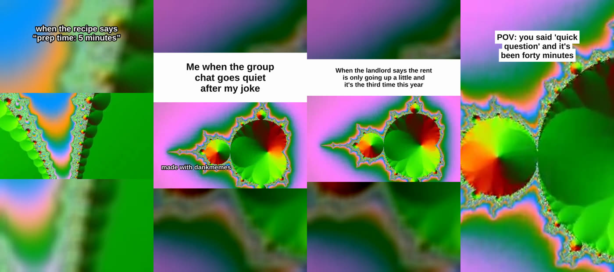

# Pipeline review, November 2026

A full read of how a video becomes clips, judged against one goal: **clips people actually find funny and share.**
The craft behind that goal is written down in [meme-craft.md](meme-craft.md); this page is what was checked, what was
changed, and what is still open.

## Was the site built from a plan in the repo?

No. The repo had no landing page or design plan. `docs/meme-builder.md` describes the pipeline only. The landing page,
studio and pricing page were designed fresh on top of the existing app, with every price and limit read from
`src/plans.js`.

## How this was tested

- There are no AI keys in the build environment, so **no run used a real model**. Caption quality from real models is
  untested and is the biggest open item (see the gaps below).
- Every prompt change is covered by tests that read the exact prompt sent to the model (`tests/craft.test.js`,
  `tests/meme-builder.test.js`).
- Rendering was tested with real ffmpeg on a 640x360 test video and a phone-shaped (9:16) copy of it. A test also reads
  pixels from a real render to check that the card is white and the video sits right under it.
- The full suite passes: 307 tests, run locally against Postgres.

## The pipeline, stage by stage

| Stage | What it does | Verdict |
|---|---|---|
| Find moments (`analyze.js`) | A video model watches a 360p, 10 fps copy (up to 25 minutes in one pass) and lists moments with their feeling, social dynamic, intensity, whether the words are neutral, and setup and payoff bounds. | Strong. It asks for feeling over topic, which is the core of the craft. Its one example was about trucking and is now neutral. |
| Audience (`personas.js`) | A deep profile: vocabulary, pains, in-jokes, people, never-say list, formats, good vs bad, plus a situation bank of recurring moments. | The built-in truckers profile is excellent. **Custom audiences were much weaker** (fixed, see 2 below). |
| Captions (`captions.js`) | 5 moments per call, 3 candidates each, 3 starting situations per clip from the bank, already-used captions passed on, harsh 1 to 10 score. | Good structure. **Trucking leaked into every audience** (fixed, see 1). The craft rules were partly implicit (now explicit, see 3). |
| Pick (`selectClips`) | Above the minimum score, no overlaps, up to the plan's clip cap. | Fine. |
| Verify (`refine.js`) | A short excerpt of each clip is watched with the candidate captions: is the moment there, exact cut points, which caption fits, fit 1 to 10. Fit 3 or less is dropped. | The best quality step in the pipeline. **Dropped clips were lost, and the final order ignored the fit** (fixed, see 4). |
| Cut (`cuts.js`) | Edges snap to pauses in speech. | Good: no clipped words. |
| Render (`render.js`) | 9:16 frame, caption burned in, audio levelled to about -16 LUFS, watermark on watermarked plans. | **The caption looked like a subtitle floating over a blur** (fixed, see 5). Audio handling is careful and good. |
| Runner (`worker.js`) | One run at a time per machine, oldest first; heartbeat every 30 s; stuck runs requeued; 3 automatic retries for temporary AI errors; 45 minute watchdog. | Reliable. Fairness between plans is open (see gaps). |

## What changed, ranked by impact

1. **Every audience got trucker jokes.** The shared caption rules used broker and dispatcher examples, the spice rule
   named "sleeper-berth innuendo", and the overused-topics line ("the 14-hour clock, blind-side backing, detention, the
   lowball broker") was sent to every audience. A nurses or gamers audience was being steered toward trucking.
   Now the shared rules are audience-neutral, and overused topics and spice are per audience (`overused_topics`,
   `spice_notes`), with the truckers' own values moved into their profile.
2. **Custom audiences had no situation bank.** The bank is what keeps 30 captions from circling the same five jokes,
   and custom audiences, the main path for real customers, never got one. Now a bank (16 to 20 areas of life, 8 to 10
   situations each) is built when the audience is created, in a second, separate AI call. Audiences made before this
   get theirs on their first run, saved for next time. Neither step can fail the audience or the run.
3. **The craft is now explicit in the prompts.** Setup and punchline, relatable, specific, instant, short, never explain
   the joke, vary the format. The score now has a definition: a 7 or more needs all four of relatable, specific,
   instant, and the clip is the punchline. The verify step now asks for tight cuts on quick reactions (about a second
   of lead-in, then stop after the reaction lands). Three of the truckers' example captions put the whole joke in the
   caption, so the writer was learning that pattern; they were rewritten as setups.
4. **Clips the check dropped were simply lost.** A run asked for 12 could come back with 8. Now a few spares (a
   quarter more, between 3 and 10) are checked along with the picks, so a dropped clip is replaced. The final order is
   by the watched fit, best first, rather than by the writer's own guess.
5. **The caption card.** Before: white outlined text floating near the top, far from a small video, over a busy blur.
   After: the layout people recognise as a meme, a white card with big black bold text sitting directly on top of the
   video, the pair a little above the middle and clear of the app's buttons, over a darkened blur. Long captions step
   down in size to stay within 4 lines, and lines are balanced so a caption never ends on one orphaned word. Phone
   videos fill the frame with the caption on white boxes near the top. Rotated phone videos are now measured upright.

## What is still open, ranked

1. **No real-model test yet.** Nothing above proves the captions are funnier, only that the instructions are right.
   With a Google AI key (and ideally an Anthropic key for captions), run 5 to 10 real videos across two or three
   audiences, grade 50 clips by hand against [meme-craft.md](meme-craft.md), and keep them as a fixed test set so every
   later prompt change can be compared against it.
2. **Cost per minute is unmeasured.** A run makes one watch of the whole video, one caption call per 5 moments, and one
   watch per picked clip (now including spares). The real cost per source minute needs those same real runs, and it
   decides whether the pricing floor of $0.15 a minute holds.
3. **The feedback loop is thin.** Thumbs up and down feed the last 15 of each into the next run's prompt. Downloads and
   copies, which are the real "people share this" signal, are not used yet.
4. **Queue fairness.** Runs go oldest first, one per machine, so a paying customer can wait behind a queue of free
   runs. Giving paid plans priority is a small change, but it is a product decision.
5. **Framing.** There is no face or speaker tracking, so a wide shot with a small face stays small. The card layout
   makes this matter less than before.
6. **Creating an audience takes longer.** The situation bank is a second AI call, so making a custom audience now
   waits for two answers instead of one.
